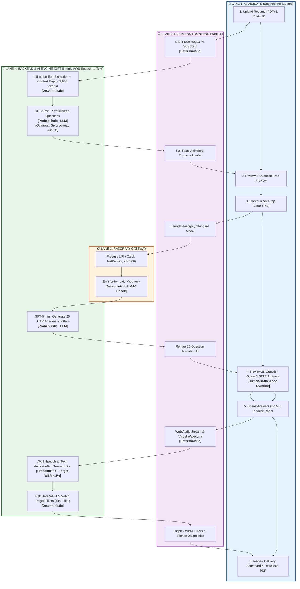

# Deliverable 04: UX, Workflow, and Trust Design

## 1. UX Principle & Human-AI Interaction Philosophy
PrepLens AI is explicitly designed as an **augmented interview coach**, not an autonomous evaluator. The interaction model treats Generative AI as a probabilistic drafting engine, ensuring that the **Candidate remains the ultimate decision-maker** who critiques, edits, and adopts the model answers.

---

## 2. Mermaid Swimlane Workflow Diagram

This diagram visually delineates the boundaries between the Candidate, the Web Interface, the Payment Gateway, and the AI/LLM backend, explicitly identifying **Deterministic** processes, **Probabilistic** AI stages, **Hallucination Risk points**, and **Human-in-the-Loop (HITL)** controls:

---

## 3. Trust, Transparency, and Explainability Architecture

To foster trust without creating blind over-reliance, the user interface adheres to strict explainability guidelines:

* **What the Candidate Needs to Know:** Model Answers are structural scaffolding (using the STAR framework), not literal scripts to be memorized word-for-word.
* **What Must Be Explicitly Visible:**
  * **Keyword Provenance Tags:** Each question displays the specific skill tag extracted from the JD or Resume (e.g., `Grounded in: React Context API + Project: E-Commerce Store`), proving the question was tailored and not hallucinated.
  * **Latency Micro-States:** When generating questions, the animated loader displays active micro-copy (e.g., *"Analyzing requirements..."* $\rightarrow$ *"Cross-referencing resume..."* $\rightarrow$ *"Formatting rubric..."*) so the candidate understands that complex synthesis is occurring.
* **What Must Be Hidden:** Raw API system instructions, internal token counts, and intermediate temperature parameters.

---

## 4. Probabilistic vs. Deterministic Uncertainty Handling

| Execution Type | System Stage | High-Confidence Behavior | Low-Confidence / Ambiguous Behavior | Failure / Fallback Behavior |
| :--- | :--- | :--- | :--- | :--- |
| **Deterministic** | Resume & JD Intake | Scanned PDF text extracted cleanly (>500 chars). | Text extracted is brief (<100 chars); UI displays non-blocking warning to provide more context. | Scanned image-only PDF yields 0 characters; UI prompts candidate to paste skills manually. |
| **Probabilistic** | Question Generation | Questions directly map to JD technical stack. | Candidate resume has zero overlap with target JD; system flags mismatch and generates baseline domain questions. | LLM API timeout (>8.0s); catches error, retries once, and falls back to curated domain template. |
| **Deterministic** | Payment Verification | Razorpay HMAC signature validates instantly. | Webhook delayed by network; UI polls order status for up to 30 seconds. | Payment fails or is cancelled; preserves 5-question state and displays 20% discount coupon (`PREP20`). |
| **Probabilistic** | Speech Recognition (STT) | Audio transcribed cleanly with WER < 5%. | Audio contains heavy background noise or thick accent; technical terms biased via phonetic IT dictionary. | Microphone blocked or audio capture drops; system prompts 1-click permission fix or offers text-chat mode. |
| **Deterministic** | Speech Analytics | WPM calculated accurately (110–150 WPM benchmark). | Short response (<15 seconds); flags sample as "Too brief to compute pacing metric accurately." | Zero speech detected; flags "No audio received, please verify microphone input." |

---

## 5. Human-in-the-Loop (HITL) Controls

The candidate is never a passive consumer; the workflow enforces three active review gates:
1. **The Customization Gate:** Candidates can edit any AI-generated model answer directly in the browser to reflect their actual personal speaking style before downloading.
2. **The Feedback Gate:** Every generated question includes a 1-click flag icon (*"Inaccurate Tech Concept"*), sending the query to an admin review queue to refine system prompts.
3. **The Practice Gate:** Candidates evaluate their own diagnostic scorecard (WPM and filler words) to decide whether to re-record an answer or move forward.
