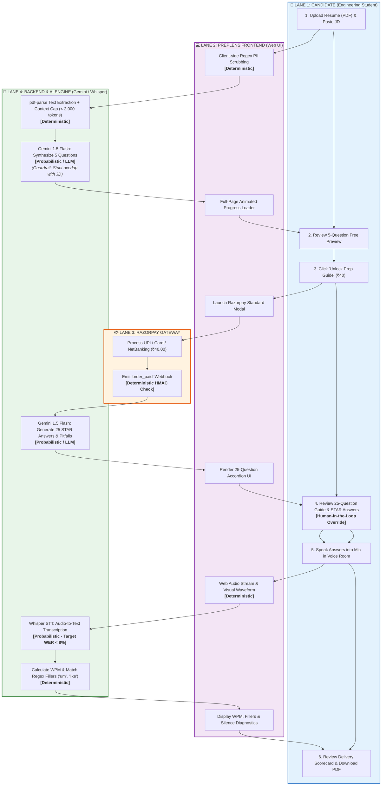

# Product Requirements Document (PRD)

# Product: PrepLens AI
**Subtitle:** Intelligent, Domain-Specific Interview Coach & Preparation Engine  
**Author:** Yuvaraj (PrepLens Labs)  
**Student Roll Number:** `2025mb26082`  
**GitHub ID:** `yuvaraja77`  
**Course:** MBA ZG583 — Management of AI Products  
**Status:** Approved / Active MVP Development  
**Target Release:** Capstone Pilot  
**Document Version:** 1.1.0  

---

## 1. Executive Summary & Problem Framing

### 1.1 Problem Statement
Technical job seekers—specifically engineering freshers and early-career developers—suffer from a **70% to 90% rejection rate** in technical screening rounds. While technically competent, candidates fail because they prepare for general textbook definitions rather than the exact tech stack and operational context specified in the employer’s **Job Description (JD)**.

Current alternatives fail to solve this:
* **Static Question Banks (GeeksforGeeks, Glassdoor):** Provide generic lists ("Top 50 Java Questions") that completely ignore the candidate's unique resume projects and the specific company's architectural requirements.
* **Raw Prompting (ChatGPT):** High cognitive friction; requires expert prompt engineering to extract structured rubric-based answers; lacks audio simulation, pacing analytics, and payment-gated preparation guides.
* **Human Mentorship:** Cost-prohibitive (₹2,500–₹5,000/hour), making repeated mock practice financially unviable for university students.

### 1.2 Product Vision
PrepLens AI acts as a personal, domain-specific AI recruiter in every job seeker's pocket. By synthesizing the unique overlap between an engineering candidate's resume and a target JD, PrepLens generates hyper-personalized questions, structured model answers, and a live, voice-enabled mock interview room with real-time speech pacing analytics.

---

## 2. Goals & Explicit Non-Goals

### 2.1 Goals (In-Scope for Version 1.0 MVP)
* Provide a zero-friction, freemium entry point generating 5 custom-tailored interview questions from an uploaded resume and pasted JD.
* Enable a seamless micro-transaction (₹40 via Razorpay) to unlock a 25-Question Comprehensive Prep Guide with structured "Approach + Ideal Answer + Common Pitfalls."
* Deliver an interactive, browser-based Voice Mock Interview room powered by real-time Speech-to-Text (STT).
* Generate an automated post-interview analytical scorecard evaluating speech delivery (Words Per Minute, filler words, pause frequency).
* Provide offline export capability (Download Guide as formatted PDF/Text).

### 2.2 Non-Goals (Strictly Out of Scope for Initial Release)
* **Autonomous Candidate Screening for Recruiters (B2B ATS):** Deferred to Version 4.0; initial product strictly targets job seekers (B2C).
* **Live Video / Facial Emotion Analysis:** Avoided to eliminate high video-streaming compute costs and avoid unscientific metrics.
* **Full-fledged Code Execution Sandbox:** Coding tests are already saturated by LeetCode/HackerRank; PrepLens focuses on technical design discussions, behavioral scenarios, and project cross-examination.

---

## 3. Target Candidate Personas

### Persona A: "Arjun" – Final-Year B.Tech Student (Primary)
* **Demographics:** 21 years old, Computer Science student preparing for upcoming campus placement drives.
* **Behavior:** Has built standard academic projects (e.g., e-commerce app, portfolio), but panics when asked how his projects scale or handle production traffic.
* **Key Need:** Needs an instant, tailored list of likely interview questions matching his resume to specific company JDs, along with structured sample answers.
* **Willingness to Pay:** Sensitive to recurring subscriptions (cannot afford ₹500/month), but readily pays ₹40 as a single-event purchase before a scheduled interview.

### Persona B: "Priya" – Junior Developer / Career Switcher (Secondary)
* **Demographics:** 24 years old, 1.5 years experience in IT support, transitioning to a Junior React/Node.js role.
* **Behavior:** Possesses strong technical comprehension, but suffers from verbal anxiety during live interviews—speaking either too rapidly (>180 WPM) or freezing up.
* **Key Need:** Needs a safe, repeatable voice simulation environment to practice articulating technical concepts aloud and receive objective delivery pacing metrics.

---

## 4. End-to-End Swimlane Workflow Diagram

The workflow spans four distinct actors, explicitly identifying **Deterministic** processes, **Probabilistic Generative AI** stages, **Hallucination Risk points**, and **Human-in-the-Loop (HITL)** controls:



---

## 5. Functional Requirements (FR)

### FR-1: Candidate Profile & Context Ingestion
* **Description:** Ingests candidate career stage, industry, resume, and target job description.
* **User Story:** *As an engineering job seeker, I want to upload my resume and paste a job description so that the AI can understand my exact profile and target role.*
* **Specifications:**
  * Supported resume formats: `.pdf`, `.docx` (Max size: 5 MB).
  * System utilizes server-side text extraction (e.g., `pdf-parse`).
  * Input sanitization: Strips non-UTF8 characters, script tags, and excessive whitespace.
  * Validation: Requires JD text to be at least 50 characters in length.

### FR-2: Freemium Question Generation (5 Questions)
* **Description:** Single-shot LLM inference generating an initial 5-question preview.
* **User Story:** *As a candidate, I want to see an immediate preview of custom questions for free so that I can verify the AI's relevance before paying.*
* **Specifications:**
  * Categorization: 3 Technical Core, 1 Project-Specific, 1 Behavioral.
  * System enforces JSON output schema (`{ questions: [ { category, question, rationale } ] }`).
  * UI renders a full-page animated loader with status micro-copy ("Analyzing tech stack...", "Cross-referencing resume...") to maintain engagement during generation.

### FR-3: Payment Processing & Order Verification (Razorpay)
* **Description:** Frictionless micro-transaction checkout for ₹40.
* **User Story:** *As a candidate, I want to securely pay ₹40 using UPI or cards so that I can instantly unlock my full prep guide.*
* **Specifications:**
  * Integrated with Razorpay Standard Web Checkout.
  * Required fields: Full Name, Email Address.
  * Server-side signature verification (`crypto.createHmac`) validating `razorpay_payment_id` and `razorpay_order_id`.
  * Idempotent unlock: Issues an authenticated session token upon webhook verification (`order_paid`).

### FR-4: Comprehensive 25-Question Prep Guide & Scaffolding
* **Description:** Full preparation guide with structured answer scaffolding.
* **User Story:** *As a paid candidate, I want structured model answers and common mistakes for 25 questions so that I know exactly how to structure my answers.*
* **Specifications:**
  * Delivers 25 questions grouped into 3 distinct tabs/sections:
    1. **Technical Core (10 questions):** Deep dive into specific frameworks and languages from the JD.
    2. **Project Deep-Dive (8 questions):** Questions directly interrogating bullet points extracted from the uploaded resume.
    3. **Behavioral & Scenario (7 questions):** Culture fit and conflict resolution using STAR methodology.
  * **Answer Scaffolding Structure:**
    * *The Strategic Approach:* How to think through the answer.
    * *The Ideal Model Answer:* Formatted answer customized to the candidate's experience.
    * *Common Pitfalls:* Exact rookie mistakes that trigger interviewer red flags.
  * Action: Downloadable offline as formatted PDF / Text.

### FR-5: Voice-Enabled AI Mock Interview Room
* **Description:** Simulated interview environment with real-time audio capture.
* **User Story:** *As a candidate, I want to answer interview questions out loud into my microphone and see my speech transcribed in real-time.*
* **Specifications:**
  * Audio capture via browser Web Speech API / MediaStream Audio Recording.
  * Displays one question at a time with a 2-minute countdown timer.
  * Live acoustic visualizer (waveform/pulsing mic) to confirm audio reception.
  * Candidates can submit their verbal response or click "Skip".

### FR-6: Behavioral Speech Analytics & Scorecard
* **Description:** Automated post-interview delivery diagnostic dashboard.
* **User Story:** *As a candidate, I want an objective evaluation of my speech rhythm so I know if I am rambling or speaking too quickly.*
* **Specifications:**
  * **Words Per Minute (WPM):** Calculated as `(Total Word Count / Duration in Minutes)`.
    * *< 110 WPM:* Flagged as "Hesitant / Low Pacing"
    * *110–150 WPM:* Flagged as "Optimal Professional Cadence"
    * *> 160 WPM:* Flagged as "Rushed / Rapid Delivery"
  * **Filler Word Detection:** Regex counter scanning for `"um"`, `"uh"`, `"like"`, `"basically"`, `"actually"`, `"you know"`.
  * **Prolonged Silence Counter:** Flags pauses exceeding 3.0 seconds.

---

## 6. Non-Functional Requirements (NFR) & Concrete SLA Benchmarks

To eliminate ambiguity, all performance, security, and availability targets are explicitly quantified:

| SLA Category | Metric Name | Measurement Condition | Target Numerical Value |
| :--- | :--- | :--- | :--- |
| **Performance** | Free 5-Question Latency | End-to-end server response time | **< 3.5 seconds (P95)** |
| **Performance** | Comprehensive 25-Guide Latency | End-to-end JSON delivery time | **< 7.0 seconds (P90)** |
| **Performance** | Voice STT Turnaround | Audio stream completion to transcript display | **< 1.2 seconds** |
| **Quality** | Speech-to-Text Transcription | Benchmark against 100 Indian-accented technical terms | **Word Error Rate (WER) < 8.0%** |
| **Quality** | JSON Schema Conformance | Validated against UI parsing schema | **> 99.5% valid JSON** |
| **Security** | PII Sanitization | Client-side redaction of phone numbers & street addresses | **100% pre-payload redaction** |
| **Privacy** | Data Retention Policy | Third-party LLM endpoint data policy | **Zero-Data Retention (ZDR Contracted)** |
| **Availability** | Web App Uptime | Monitored during peak campus hours (8 AM – 11 PM IST) | **>= 99.5% Availability** |

---

## 7. Edge Cases & Failure Recovery Matrix

| Trigger / Failure Scenario | Operational Impact | System Fallback & Recovery Mechanism |
| :--- | :--- | :--- |
| **Image-Only / Scanned PDF Resume** | Text parser yields 0 characters | System displays a non-blocking modal: *"We couldn't detect text in this scanned file. Please upload a standard text PDF or type your key skills manually."* |
| **Ultra-Short Job Description (< 50 chars)** | Insufficient context for LLM | Generation CTA is disabled with helper hint: *"Please provide at least a brief role summary so questions can be properly tailored."* |
| **LLM API Timeout (> 8.0s)** | Candidate hangs on loader | System catches timeout, triggers an immediate fallback retry with backoff, and if failed, renders an offline domain template pack while preserving the candidate's payment credits. |
| **Microphone Permission Denied** | Voice room unusable | In-app banner provides 1-click browser permission instructions, with a toggle to *"Switch to Text-Chat Mode"*. |
| **Payment Abandonment / Failure** | Candidate drops off at gateway | Razorpay dropoff logged to Supabase; candidate remains on the 5-question screen with an inline 20% discount coupon banner (`PREP20`). |

---

## 8. Telemetry, Analytics & Quantified Success Metrics

```
[North Star Metric]
Weekly Completed Interview Preps (Guide Generation + >= 3 Questions Practiced)
Target: > 500 completed sessions / week during campus placement season

                     +---------------------------------------+
                     |                                       |
          [Candidate Engagement]                    [Monetization & Economics]
- 5-Question Generation Success Rate: >= 98.0% - Free-to-Paid Conversion Rate: Target 3.5%
- Mock Room Completion Rate: >= 65.0%         - Variable COGS per Paid Session: <= ₹6.52
- Guide Download Rate: >= 40.0% of paid users  - Net Contribution Margin: >= 80.0%
```

---

## 9. Release Criteria & Go/No-Go Checklist

* [x] **Zero Fatal Crashes:** 100 consecutive automated test runs through Resume Upload → Paywall → Guide Generation without unhandled exceptions.
* [x] **Payment Verification:** End-to-end Razorpay sandbox verification with successful HMAC signature validation on 100% of test transactions.
* [x] **Voice Accuracy:** STT Word Error Rate (WER) tested at **< 8.0%** across Indian-accented technical terms.
* [x] **Cost Guardrail Enforced:** Mock interview voice sessions strictly capped at 5 questions / 10 minutes maximum recording time to protect gross margins (>80%).
