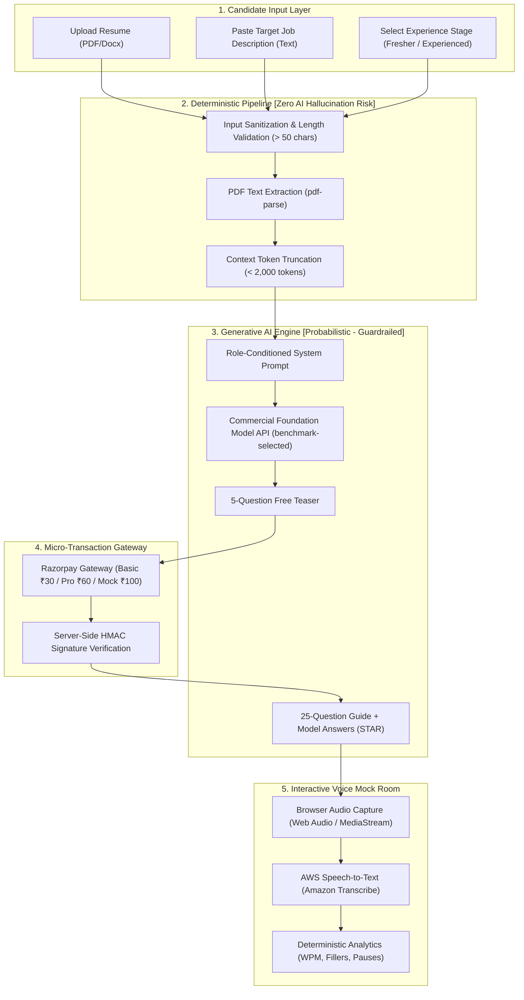

# PrepLens AI: Management of AI Products Capstone (MBA ZG583)

## 📌 Student & Submission Metadata
* **Student Name:** Yuvaraj
* **Roll Number:** `2025mb26082`
* **GitHub ID:** `yuvaraja77`
* **Course:** MBA ZG583 — Management of AI Products (S1-26_MBAZG583)
* **Team Name:** PrepLens Labs (Approved Solo Project)
* **Live Product Demo:** [https://preplensai.app](https://preplensai.app) *(or your deployed link)*
* **Repository:** `https://github.com/yuvaraja77/prep-lens`

---

## 🚀 1-Minute Executive Summary 
**PrepLens AI** is an intelligent, domain-specific interview coach engineered to eliminate candidate interview failure caused by **preparation-context mismatch**. 

* **The Problem:** Technical job seekers often prepare with generic interview content that is disconnected from the specific role and their own experience. The scale and causes of this gap are treated as **pilot hypotheses to validate**, not as universal rejection statistics.
* **The Solution:** PrepLens synthesizes an unstructured candidate resume alongside the target JD to generate hyper-personalized questions, structured model answers, and a live voice-simulated mock interview room with real-time speech analytics.
* **The Business Model:** An event-driven one-time purchase model with **Basic ₹30, Pro ₹60, and AI Mock Interview ₹100**. Contribution margin, CAC, repeat purchase, and LTV are **pilot measurements to validate**, not claimed production results.

---

## 🔄 Product Evolution
The original approved topic focused on hiring managers/recruiters. During product development, PrepLens was deliberately reframed as a **B2C candidate-preparation product** because the most tangible MVP value was contextual preparation and practice. The historical `topic_approval_form.md` is retained unchanged; the PRD, strategy, prototype, and presentation reflect the current direction. The original ₹40 bundle was also replaced by separate **Basic ₹30, Pro ₹60, and AI Mock Interview ₹100** paths so value and cost-to-serve can be measured independently.

## 🗂️ Complete Product Management Artifact Index

As instructed for the capstone submission, all artifacts are documented in unambiguous, AI-evaluable Markdown (`.md`) format:

| Artifact File | Description & Core PM Value |
| :--- | :--- |
| **[`PRD.md`](./PRD.md)** | **Primary Mandatory Artifact:** Comprehensive Product Requirements Document containing user personas, 6 functional specifications, non-functional latency/security SLAs, failure edge cases, and Go/No-Go release criteria. |
| **[`01_Executive_Summary.md`](./01_Executive_Summary.md)** | 2-page leadership briefing synthesizing problem, market size, AI justification, economics, and pilot recommendation. |
| **[`02_Product_Strategy.md`](./02_Product_Strategy.md)** | Product vision, JTBD (functional, emotional, social), RICE opportunity matrix, and **Course Case Study Benchmarking (OpenAI Pricing & Yellow.ai)**. |
| **[`03_PM_Artifact_Pack.md`](./03_PM_Artifact_Pack.md)** | Detailed Persona profiles ("Arjun" the fresher, "Priya" the career switcher), phased 4-version roadmap, and quantitative metric trees. |
| **[`04_UX_and_Workflow.md`](./04_UX_and_Workflow.md)** | **Mermaid Swimlane Workflow Diagram** classifying deterministic vs. probabilistic steps, hallucination risk points, and Human-in-the-Loop review gates. |
| **[`05_Data_Model_Evaluation.md`](./05_Data_Model_Evaluation.md)** | AI task decomposition, context token budgeting (<2,000 tokens), **LLM-as-a-Judge offline evaluation harness**, and quantitative SLA thresholds. |
| **[`06_Business_Scaling.md`](./06_Business_Scaling.md)** | Target-costing logic, contribution-margin measurement by Basic/Pro/Mock workflow, voice-usage guardrails, and a pilot plan for validating CAC, repeat purchase, and LTV. |
| **[`07_Ethics_Governance.md`](./07_Ethics_Governance.md)** | DPDPA 2023 compliance, Zero-Data Retention (ZDR) enterprise policies, regional Indian accent bias mitigations in STT, and launch blockers. |
| **[`08_Prototype_Readme.md`](./08_Prototype_Readme.md)** | Prototype documentation outlining what the live application proves vs. what is deferred. |
| **[`09_AI_Collaboration_Log.md`](./09_AI_Collaboration_Log.md)** | Transparent disclosure of AI tool usage, prompt evolution, AI weaknesses, and human PM strategic overrides. |
| **[`10_Individual_Contribution.md`](./10_Individual_Contribution.md)** | Solo contributor disclosure documenting artifact ownership and validation rigor. |
| **[`Presentation_Outline.md`](./Presentation_Outline.md)** | 4-slide, 10-minute VC pitch deck script for the final capstone presentation. |

---

## 🏗️ System Architecture & Workflow Diagram



---

## 🎯 Verification & Testing Strategy

To ensure operational credibility and eliminate production failure risks, PrepLens implements a three-tier verification framework combining deterministic unit testing, probabilistic AI guardrail validation, and an end-to-end evaluator walkthrough:

### 1. Automated Test Suites (Software & Deterministic Logic)
The repository includes 6 automated test suites (`backend/tests/`) built with Jest and Supertest, ensuring all deterministic components behave predictably:

| Test Suite | Purpose & Coverage | Target Pass Criteria |
| :--- | :--- | :--- |
| **`logic.test.js`** | Validates resume text extraction (`pdf-parse`), prompt parameter formatting, and JD input length validation. | **100% Pass** (0 unhandled exceptions on malformed files) |
| **`mockInterview.test.js`** | Tests speech diagnostic math (WPM calculation, pause duration detection, filler word regex counting). | **100% Pass** (Deterministic accuracy across all speech lengths) |
| **`coupons.test.js`** | Validates discount calculation algorithms, coupon expiration dates (`PREP20`), and edge cases. | **100% Pass** (Prevents negative or incorrect checkout amounts) |
| **`routes.test.js`** | End-to-end API health, payload schema validation, HTTP error status codes, and route handlers. | **100% Pass** |
| **`feedback.test.js`** | Tests error logging, candidate issue reporting, and analytics tracking in Supabase. | **100% Pass** |
| **`support.test.js`** | Validates support ticket creation, contact form payload sanitization, and alert dispatch. | **100% Pass** |

**Execute Automated Tests:**
```bash
cd backend
npm test
```

---

### 2. AI Model & Guardrail Verification (AI PM Layer)
Because generative AI is probabilistic, the system enforces strict automated checks around the model's outputs and costs:
* **JSON Schema Conformance:** Automated schema validation verifies that model responses parse directly into the UI's question/answer accordion structure without syntax breaks (Benchmark: `> 99.5% valid JSON`).
* **Context Budgeting Enforcement:** Pre-flight token truncation algorithms ensure resume and JD inputs never exceed the `< 2,000 prompt token` budget, so cost and latency remain within defined pilot guardrails; actual cost is measured from provider usage logs.
* **Acoustic Transcription Accuracy:** AWS Speech-to-Text (Amazon Transcribe) is benchmarked against a 100-sample test set of Indian-accented technical terms (Target: `Word Error Rate (WER) < 8.0%`).
* **Deterministic Fallback Gate:** In-memory checks simulate image-only PDF uploads and network timeouts to verify that the app displays polite guidance and switches to manual/text mode rather than crashing.

---

### 3. Evaluator's 3-Minute Walkthrough (Live Happy-Path Verification)
Evaluators or faculty members can test the live application in under 3 minutes using the following test scenario:
1. **Navigate:** Open the live app at [https://preplensai.app](https://preplensai.app).
2. **Intake:** Select **"Fresher"** and industry **"IT / Software"**.
3. **Test Context:** 
   * Paste a brief technical job description (e.g., *"Junior React Developer with knowledge of JavaScript, HTML/CSS, REST APIs, and Git"*).
   * Upload any standard computer science resume (or use sample text).
4. **Generate Free Preview:** Click **"Generate Questions"**. Verify that the full-page animated status loader appears and that 5 custom-tailored interview questions render in `< 3.5 seconds`.
5. **Test Voice Mock Room:** Enter the AI Mock Interview room, allow microphone access, speak an answer for 30 seconds, and observe real-time speech-to-text transcription followed by the WPM delivery scorecard.
